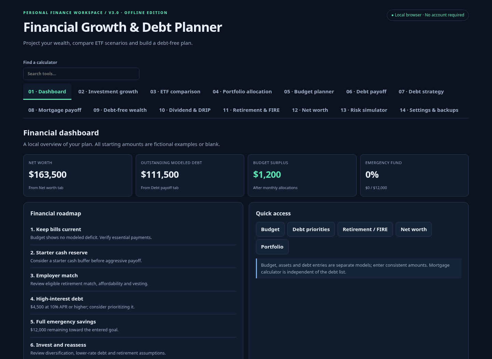

# Financial Growth & Debt Planner

  

A privacy-focused, browser-based personal finance toolkit for comparing investment growth, paying down debt, and planning long-term financial independence.

**[Launch the planner]([https://pwnren.github.io/financial-growth-debt-planner/](https://github.com/pwnren/financial-growth-debt-planner/blob/main/dashboard.png))** · **[Download standalone HTML](https://raw.githubusercontent.com/pwnren/financial-growth-debt-planner/main/index.html)**

## Features

| Tool | Capabilities |
|---|---|
| Financial dashboard | Budget surplus, debt, net worth, cash goal and financial roadmap |
| Investment growth | Weekly, monthly and annual projections, contributions, inflation and CSV |
| ETF comparison | Adjustable return scenarios, Yahoo Finance links and ETF Research Center overlap tool |
| Portfolio allocation | Five editable holdings, weights, assumed gross returns and fee impact |
| Budget planner | Income, spending, savings, investment and debt allocations |
| Debt payoff | Avalanche, snowball, minimum payments, payoff schedules and CSV |
| Debt strategy | Priority ranking, emergency reserve and debt-versus-investing guidance |
| Mortgage payoff | Fixed-rate amortization, extra principal and payoff comparison |
| Debt-free wealth | Reinvest freed payment budgets and compare debt strategies |
| Dividend & DRIP | Reinvested distributions versus cash distributions |
| Retirement & FIRE | Real-return projection, FI target, retirement age and spending runway |
| Net worth | Assets, liabilities, dated snapshots and CSV |
| Risk simulator | 1,000 seeded Monte Carlo paths, one-time crash and DCA comparison |
| Settings & backups | Local profiles, JSON import/export and dark/light themes |

## Screenshots

Portfolio, retirement, risk, and original tools

## Run locally

Download `index.html` and open it in a modern browser. No dependencies, accounts, backend, or API keys. The HTML contains all calculator code and styling. Optional hosted offline caching needs the accompanying service worker, manifest and icons.

## Deploy to GitHub Pages

Upload the contents of this package into your repository root (including `.nojekyll`). In Settings → Pages, choose Deploy from a branch, `main`, `/ (root)`, and Save. GitHub will display your published URL. The optional progressive web app caches the app after a successful hosted visit; install availability depends on browser support.

## Privacy & assumptions

Calculations are local, with no analytics, external scripts or bank connections. Optional browser storage and exported JSON are unencrypted. Avoid sharing backups or using shared computers for private plans. Example inputs are fictional. Each calculator has its own assumptions; mortgage is separate from the debt list, and budget/net worth fields must not double count balances or payments. ETF returns, fees, dividends and simulations are editable assumptions, not live prices, forecasts or actual fund performance. All calculators are educational, not individualized financial advice. External links require internet access.

See [CHANGELOG](changelog.md), [PRIVACY](privacy.md), [SECURITY](security.md), [ROADMAP](roadmap.md) and [CONTRIBUTING](contributing.md). A software license has not been selected; do not assume an open-source license applies.

## Testing

Run `pip install playwright`, `python -m playwright install chromium`, then `python tests/smoke.py`. The GitHub Actions workflow runs these smoke tests on pushes and pull requests. These tests exercise tabs, a compound-growth example, backup model roundtrip, deterministic random seed, net worth snapshot, theme and debt linkage. They do not establish financial suitability or exhaustive numerical accuracy.
